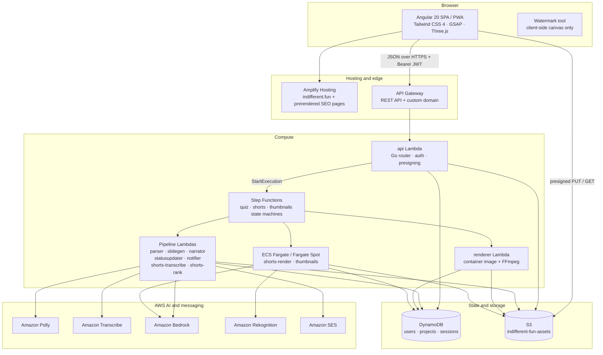
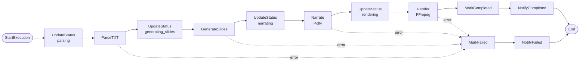
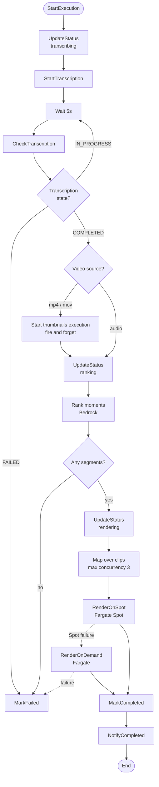
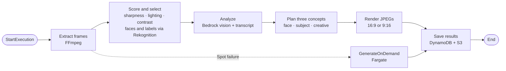
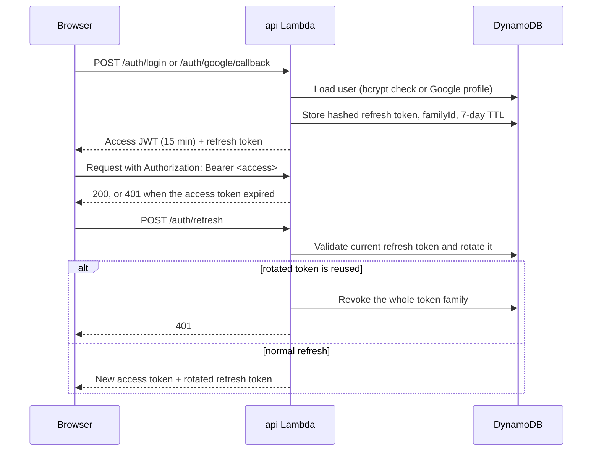

# TXT2Video (Indifferent)

**TXT2Video** is the AI video studio behind [indifferent.fun](https://indifferent.fun). It turns plain text and long recordings into publish-ready video:

- **Quiz films** — upload a `.txt` file of multiple-choice questions and get a narrated 1920×1080 MP4 with answer reveals, transitions and optional channel branding.
- **AI Shorts** — upload a video or audio file up to 1 hour / 2 GB and get up to three ranked 1080×1920 clips with burned-in captions and face-aware framing.
- **Watermark tool** — add a watermark to an image entirely in the browser; nothing is uploaded to a server.

One account holds every quiz project and shorts job, with progress, previews, thumbnails and downloads in one place. Output is ready for YouTube, Shorts, Reels or any other platform.

**Live:** https://indifferent.fun

**Stack:** Angular 20 · Go 1.26 · AWS Step Functions · ECS Fargate · Amazon Polly · Transcribe · Bedrock

## Contents

- [What it does](#what-it-does)
- [Architecture](#architecture)
- [Quiz film pipeline](#quiz-film-pipeline)
- [AI Shorts pipeline](#ai-shorts-pipeline)
- [AI thumbnails pipeline](#ai-thumbnails-pipeline)
- [Authentication and sessions](#authentication-and-sessions)
- [Data model](#data-model)
- [Features](#features)
- [Supported TXT formats](#supported-txt-formats)
- [Limits and output specifications](#limits-and-output-specifications)
- [Tech stack](#tech-stack)
- [Project structure](#project-structure)
- [Getting started](#getting-started)
- [Configuration](#configuration)
- [Deployment](#deployment)
- [API endpoints](#api-endpoints)
- [Testing and code quality](#testing-and-code-quality)
- [Security notes](#security-notes)
- [License](#license)

## What it does

Three products share one account, one asset bucket and one project model:

| Product | Input | Output |
|---|---|---|
| **Quiz films** | A TXT file of multiple-choice questions | A 1920×1080 MP4 with narrated questions, answer highlights and transitions |
| **AI Shorts Generator** | A video or audio file (up to 1 hour / 2 GB) | Up to three 1080×1920 clips with burned-in captions and subject-aware cropping |
| **Watermark tool** | An image, in the browser | A watermarked image. Nothing is uploaded to a server |

Projects are unified: one project holds quiz configuration, linked shorts jobs and saved watermark preferences. Everything is visible on the project page across logins, and a shorts history page lists every job newest-first.

## Architecture

TXT2Video is a serverless Go backend behind an Angular SPA. Long-running work runs in Step Functions; CPU-heavy video work runs on ECS Fargate, while short stages run as Lambda functions.



### Component responsibilities

| Component | Runtime | Responsibility |
|---|---|---|
| `api` | Lambda (Go) | REST routing, JWT auth, OAuth/password login, project and shorts CRUD, presigned upload/download URLs, starting Step Functions executions |
| `parser` | Lambda (Go) | Detects the TXT format and extracts questions, options and correct answers into structured JSON in S3 |
| `slidegen` | Lambda (Go, 1024 MB) | Renders question and answer slides as 1920×1080 PNGs using the selected design (palette, type scale and layout) |
| `narrator` | Lambda (Go) | Synthesizes question and answer narration with Amazon Polly, one MP3 per slide |
| `renderer` | Lambda container + FFmpeg | Composites slides and audio into the final MP4 and writes a thumbnail |
| `statusupdater` | Lambda (Go) | Persists pipeline status transitions and output keys in DynamoDB |
| `notifier` | Lambda (Go) | Sends a best-effort completion/failure email through SES; never fails the job |
| `shorts-transcribe` | Lambda (Go) | Starts and polls Amazon Transcribe jobs, then normalizes the transcript to S3 |
| `shorts-rank` | Lambda (Go) | Asks a Bedrock model for the most engaging moments and validates the returned segments |
| `shorts-render` | ECS Fargate / Fargate Spot | Reframes, captions and renders one 9:16 clip per task |
| `thumbnails` | ECS Fargate / Fargate Spot | Extracts frames, scores them, calls Rekognition and Bedrock, and draws three thumbnail concepts |
| `templatepreview` | Go tool | Generates preview images for the slide designs used by the landing page and API |

Each processing stage (ParseTXT, GenerateSlides, Narrate, Render) retries twice with exponential backoff (`IntervalSeconds` 3–10, `BackoffRate` 2.0). Every stage catches `States.ALL` and routes to `MarkFailed`; notification states catch their own errors so an email failure cannot change the job outcome.

## Quiz film pipeline

Source: [`backend/internal/pipeline/statemachine.json`](backend/internal/pipeline/statemachine.json)



**Stages**

1. **ParseTXT** — auto-detects numbered, bulleted or tabbed input; extracts questions, options and all correct answers; records skipped lines as warnings.
2. **GenerateSlides** — renders a question slide and an answer-reveal slide per question as 1920×1080 PNGs. Designs: `classic`, `modern`, `education`, `dark`, `minimal`, `neon`.
3. **Narrate** — reads the question, options and answer with Amazon Polly. Supported voices: Joanna, Matthew, Amy, Brian, Aditi.
4. **Render** — builds the MP4 with FFmpeg: H.264 video at 30 fps, AAC audio at 128 kbps, 1920×1080, with logo/branding overlays when configured.
5. **MarkCompleted** — stores `videoKey` and `thumbnailKey` on the project and sets status `completed`.
6. **MarkFailed** — stores the failure reason and sets status `failed`.
7. **NotifyCompleted / NotifyFailed** — sends the configured email notification if the user has a verified email and has not opted out.

## AI Shorts pipeline

Source: [`backend/internal/shorts/pipeline/statemachine.json`](backend/internal/shorts/pipeline/statemachine.json)



**Stages**

1. **Transcribe** — Amazon Transcribe runs with word-level timestamps using the requested language: `auto` (identify among `en-US`, `en-IN`, `hi-IN`), or an explicit `en-US`/`en-IN`/`hi-IN` chosen from the upload form. The raw output and a normalized transcript are written to S3. Job names are deterministic (`shorts-<jobId>`), so retries are idempotent; a stale failed job is deleted and restarted.
2. **Thumbnails (optional)** — for `.mp4`/`.mov` sources, a separate thumbnails state machine starts alongside ranking. It is fire-and-forget: thumbnails never delay or fail the clips.
3. **Rank** — the transcript is condensed to one line per block (about 360 lines for a one-hour file instead of thousands of word tokens) and sent to Bedrock. Ranking defaults to Moonshot Kimi K3 (`global.moonshotai.kimi-k3`); `RANKING_MODEL=nova` or `claude` selects Amazon Nova Pro or Claude 3.5 Sonnet. The response is validated for boundaries, overlap, duration and rank before use.
4. **Render** — up to three clips, each 30–90 seconds, are rendered in parallel on Fargate Spot. If Spot cannot start or the task fails, the same clip falls back to on-demand Fargate.
5. **Reframe and caption** — clips are 1080×1920 at 30 fps. Rekognition samples up to eight frames per clip and the crop window follows the median face center. When no face is usable, a blur-fill fit keeps the whole frame visible over a blurred background. Captions are burned in as SRT or ASS; presets are `bold` (legacy default), `minimal`, `karaoke` (word sweep) and `clean`. Caption size, colors and alignment can be overridden per job.
6. **Complete** — the job stores its clips, boundaries and edits; `MarkCompleted` writes them and triggers the email notification.

Audio-only sources skip thumbnails and are rendered on a solid 1080×1920 canvas.

## AI thumbnails pipeline

Source: [`backend/internal/shorts/pipeline/thumbnails.json`](backend/internal/shorts/pipeline/thumbnails.json)



- Video frames are probed and extracted at planned intervals, then filtered by local measurements (sharpness, lighting, contrast) and deduplicated.
- Rekognition `DetectFaces` and `DetectLabels` add faces and objects; generic labels are ignored when scoring.
- The selected frames plus the transcript go to a Bedrock vision model. The default is Claude Haiku 4.5 (`global.anthropic.claude-haiku-4-5-20251001-v1:0`), overridable with `THUMBNAIL_MODEL`.
- Three different concepts are drawn by the app's own text renderer in the requested or source format. Preview, choose, download or regenerate them from `/shorts/:id/thumbnails`.
- The selected thumbnail is saved with the video and is returned by the downloads API.

## Authentication and sessions



- Google OAuth and email/password sign-in coexist.
- Passwords are hashed with bcrypt. Refresh tokens are random, stored hashed, and scoped to a session family.
- Access tokens live 15 minutes; refresh tokens live 7 days and slide forward on each use.
- Reuse of an already-rotated refresh token revokes the family (stolen-token detection). Rotated sessions are retained for a short window (5 minutes) so reuse can be detected.
- Session rows carry a DynamoDB TTL (`expiresAt`) so expired sessions clean themselves up.
- All project and shorts routes require a valid access token, except `GET /shorts/limits`. CORS is restricted to the production origin.

## Data model

DynamoDB is single-table per concern, with composite `PK`/`SK` keys:

| Table | Item | PK | SK | Notes |
|---|---|---|---|---|
| `indifferent-fun-users` | User profile | `USER#<userId>` | `PROFILE` | Email, display name, password hash, notification preferences |
| `indifferent-fun-users` | Email lookup | `EMAIL#<email>` | `PROFILE` | Unique email index used at signup/login |
| `indifferent-fun-sessions` | Refresh session | `SESSION#<tokenHash>` | `SESSION` | User ID, token family, `rotated` flag, `expiresAt` TTL |
| `indifferent-fun-projects` | Quiz project | `USER#<userId>` | `PROJECT#<projectId>` | Design, voice, status, S3 keys, branding, watermark, linked shorts job IDs |
| `indifferent-fun-projects` | Shorts job | `USER#<userId>` | `SHORTS#<jobId>` | Source metadata, status, progress, transcript key, ranked segments, clips, caption style, edits |
| `indifferent-fun-projects` | Thumbnail set | `USER#<userId>` | `THUMBS#<jobId>` | Generation, stage, progress, three suggestions, selection |

S3 layout (`indifferent-fun-assets`):

| Prefix | Contents | Lifecycle |
|---|---|---|
| `uploads/<userId>/<projectId>/` | Quiz TXT files and logos | Moves to Glacier Flexible Retrieval after 30 days |
| `uploads/<userId>/<jobId>/` | Shorts source media | Moves to Glacier Flexible Retrieval after 30 days |
| `temp/<projectId>/` | Generated slides and audio | Deleted after 7 days |
| `output/<projectId>/` | Final quiz video and thumbnail | Stays in Standard |
| `shorts/<userId>/<jobId>/` | Transcripts, raw Transcribe output, clips, thumbnails | Clips stay in Standard for gallery playback |

Objects under 128 KB never transition to Glacier (S3 minimum billable size). The bucket has versioning, AES-256 server-side encryption and public access blocked. Downloads use presigned URLs.

## Features

- Google OAuth + email/password authentication (bcrypt, JWT access + 7-day sliding refresh with reuse detection)
- Unified projects: quiz configuration + linked shorts jobs + watermark preferences, persistent across logins
- Upload TXT quiz files with multiple-choice questions
- Multiple correct answers per question (e.g. "Select TWO")
- 5 Amazon Polly voices (Joanna, Matthew, Amy, Brian, Aditi)
- 6 slide designs (`classic`, `modern`, `education`, `dark`, `minimal`, `neon`), each with its own palette, type scale and layout
- Real-time pipeline progress, video preview and download
- AI Shorts: transcription, Bedrock engagement ranking, subject-tracked 9:16 rendering on Fargate Spot
- Caption presets (`bold`, `minimal`, `karaoke`, `clean`), editable clip boundaries and caption text
- AI thumbnails: frame scoring, Rekognition faces/objects, Bedrock vision, three design concepts, preview/select/download/regenerate
- Shorts history dashboard and per-job clip gallery
- Channel branding: uploaded logo overlay and handle on renders
- Email notifications on completion or failure, with per-user preferences
- Glacier-aware downloads: archived videos return `202` and trigger a restore instead of a broken link
- Failure classification for shorts jobs (`failedStage`, `errorCode`) so the UI can offer a safe retry
- Light/dark theme toggle and PWA support
- Prerendered public pages, sitemap and structured data for SEO

## Supported TXT formats

### Numbered (with correct answers marked by `*`)

```text
1. What is the capital of France?
A) London
B) Paris *
C) Berlin
D) Madrid

2. Select TWO correct answers.
A) Wrong
B) Correct one *
C) Wrong
D) Wrong
E) Correct two *
```

### Bulleted

```text
What is the largest planet?
- Jupiter *
- Saturn
- Earth
```

### Tabbed

```text
What is 2+2?
	A) 3
	B) 4 *
	C) 5
```

Mark correct answers with a `*` suffix. Multiple `*` markers are supported for multi-select questions. Parsing warnings are stored on the project so skipped or malformed lines are visible instead of silently dropped.

## Limits and output specifications

**AI Shorts source limits** (enforced by the API and exposed through `GET /shorts/limits`):

- Maximum duration: 1 hour (3600 seconds)
- Maximum upload size: 2 GB (Amazon Transcribe's direct-from-S3 limit)
- Accepted types: `mp4`, `mov`, `mp3`, `wav`
- Clips per job: 3
- Clip duration: 30–90 seconds

**Quiz video output:**

- Resolution: 1920×1080
- Codec: H.264, 30 fps
- Audio: AAC, 128 kbps
- Structure per question: question slide + narration → answer-reveal slide + answer narration
- Multiple correct answers are highlighted in green with a checkmark

**Shorts output:**

- Resolution: 1080×1920 (9:16), 30 fps
- Video: H.264 (`veryfast`), source audio retained (AAC for audio-only sources)
- Captions: burned in, word-level timing from Transcribe
- Crop: face-tracked when a face is found, otherwise blur-fill

## Tech stack

| Layer | Technology | Purpose |
|---|---|---|
| Frontend | Angular 20.3 + TypeScript 5.9 | SPA |
| Styling | Tailwind CSS 4.3 + Angular Material/CDK | Layout and components |
| Animations | GSAP 3.15, Motion One, Three.js 0.186, page-flip | Landing-page hero and micro-interactions |
| Icons | Lucide | Consistent SVG icon set |
| PWA | Angular service worker + web manifest | Installable app and asset caching |
| Backend | Go 1.26 | Lambda functions, API and workers |
| Auth | Google OAuth + email/password + JWT | Authentication and sessions |
| Database | DynamoDB (on-demand) | Users, sessions, projects, shorts jobs, thumbnails |
| Storage | S3 + Glacier lifecycle | Uploads, slides, audio, clips, videos |
| Narration | Amazon Polly (Standard) | 5 English voices |
| Transcription | Amazon Transcribe | Word-level timestamps for Shorts |
| Ranking | Amazon Bedrock (Moonshot Kimi K3 by default) | Engagement scoring; Nova Pro and Claude fallbacks |
| Faces/objects | Amazon Rekognition (`DetectFaces`, `DetectLabels`) | Reframing and thumbnail scoring |
| Thumbnails | Rekognition + Bedrock vision (Claude Haiku 4.5 by default) | Three AI thumbnail concepts |
| Video | FFmpeg (static binary / container image) | MP4 composition, reframing, captions, thumbnails |
| Slides | Go native image rendering | 1920×1080 PNG generation |
| Orchestration | AWS Step Functions | Quiz, shorts and thumbnail state machines |
| Containers | Amazon ECS Fargate + Fargate Spot | Render and thumbnail tasks |
| Frontend hosting | AWS Amplify Hosting | SPA delivery and custom domain |
| API | Amazon API Gateway | REST API with custom domain |
| DNS / TLS | Route 53 + ACM | Domain and HTTPS |
| Email | Amazon SES | Completion and failure notifications |
| CI / security | GitHub Actions + CodeQL | Static analysis for Go and TypeScript |

## Project structure

```text
.
├── backend/                        # Go 1.26 Lambda functions and workers
│   ├── cmd/
│   │   ├── api/                    # REST API entrypoint
│   │   ├── parser/                 # TXT parsing worker
│   │   ├── slidegen/               # PNG slide generation worker
│   │   ├── narrator/               # Polly narration worker
│   │   ├── renderer/               # FFmpeg renderer (container image)
│   │   ├── statusupdater/          # DynamoDB status transitions
│   │   ├── notifier/               # SES completion/failure emails
│   │   ├── shortstranscribe/       # Transcribe start/poll worker
│   │   ├── shortsrank/             # Bedrock engagement ranking worker
│   │   ├── shortsrender/           # Fargate 9:16 render task
│   │   ├── thumbnails/             # Fargate AI thumbnail task
│   │   └── templatepreview/        # Slide-template preview generator
│   ├── internal/
│   │   ├── api/                    # Router, handlers, validation
│   │   ├── auth/                   # Google OAuth, passwords, JWT, sessions
│   │   ├── config/                 # Environment configuration
│   │   ├── models/                 # Shared data structs
│   │   ├── narrator/               # Polly service + handler
│   │   ├── notifier/               # Email rendering and delivery
│   │   ├── notifyprefs/            # Per-user notification preferences
│   │   ├── parser/                 # Format detection and extraction
│   │   ├── pipeline/               # Quiz state machine + status client
│   │   ├── renderer/               # FFmpeg compositor + handler
│   │   ├── shorts/                 # Transcribe, rank, render, pipeline JSON
│   │   ├── slidegen/               # Native slide renderer + themes
│   │   ├── storage/                # S3 client, presigning, Glacier restore
│   │   └── thumbnail/              # Extract, score, analyze, plan, render
│   └── templates/classic/          # Legacy HTML slide templates
├── frontend/                       # Angular 20 SPA
│   ├── src/app/
│   │   ├── auth/                   # OAuth callback, login, guards
│   │   ├── core/                   # Services, interceptors, API client
│   │   ├── pages/                  # Landing, dashboard, projects, shorts, tools, blog…
│   │   ├── projects/               # Project domain components
│   │   ├── shared/                 # Shared models and helpers
│   │   └── types/                  # TypeScript domain types
│   ├── public/                     # Manifest, icons, sitemap, robots.txt, OG image
│   ├── src/environments/           # API URL, Google client ID, redirect URI
│   └── scripts/prerender.mjs       # Post-build static prerender for SEO
├── deploy/                         # One-time and targeted AWS setup scripts
├── scripts/                        # Template preview generation
├── anti-slop/                      # Design/slop audit notes
├── DESIGN.md                       # Brand, palette, type and motion direction
├── amplify.yml                     # Amplify build configuration
└── .github/workflows/codeql.yml    # CodeQL analysis (Go + TypeScript)
```

## Getting started

### Prerequisites

- Go 1.26+
- Node.js 22+ (Angular 20 also accepts Node 20.19+ or 24+)
- Docker (for the renderer and worker container images)
- AWS CLI configured (only needed for deployment)
- FFmpeg (only needed if you run renderer code locally outside Docker)

### Local development

```bash
# Frontend
cd frontend
npm install
npm start                 # http://localhost:4200

# Backend
cd backend
go mod download
go build ./...
go test ./...
```

The frontend expects the API base URL from its environment configuration. The deployed API lives on the custom domain behind API Gateway; adjust the environment file for local pointing.

### Regenerating design previews

```bash
bash scripts/generate-template-previews.sh
```

The generated WebPs are committed because the frontend build has no Go toolchain. `go test ./cmd/templatepreview` fails when a committed preview no longer matches the renderer, and the failure points back to this script.

## Configuration

Secrets are never checked in. Start from [`deploy/.env.example`](deploy/.env.example):

```bash
cp deploy/.env.example deploy/.env
# fill in GOOGLE_CLIENT_ID, GOOGLE_CLIENT_SECRET, JWT_SECRET
source deploy/.env
```

Generate the JWT secret with `openssl rand -hex 32`.

**Common Lambda environment variables**

| Variable | Used by | Purpose |
|---|---|---|
| `S3_BUCKET` | API, workers | Assets bucket (`indifferent-fun-assets`) |
| `DYNAMODB_TABLE` | API, workers | Projects/shorts table |
| `USERS_TABLE` | API, notifier | User profiles |
| `SESSION_TABLE` | API | Refresh sessions |
| `JWT_SECRET` | API | JWT signing key |
| `GOOGLE_CLIENT_ID` / `GOOGLE_CLIENT_SECRET` | API | Google OAuth credentials |
| `GOOGLE_REDIRECT_URI` | API | OAuth callback URL |
| `STATE_MACHINE_ARN` | API | Quiz state machine |
| `SHORTS_STATE_MACHINE_ARN` | API | Shorts state machine |
| `THUMBNAIL_STATE_MACHINE_ARN` | API | Thumbnails state machine |
| `RANKING_MODEL` | `shorts-rank` | `kimi` (default), `nova`, or `claude` |
| `THUMBNAIL_MODEL` | `thumbnails` | Bedrock vision model ID |
| `SES_CONFIG_SET` / `FROM_ADDRESS` / `REPLY_TO` / `APP_BASE_URL` | `notifier` | Email delivery settings |

The deploy scripts default to region `ap-south-1` and the `indifferent-fun` project prefix. Override the values in the scripts if you deploy elsewhere.

## Deployment

The `deploy/` directory contains scripts rather than Terraform. They are intended to be run manually, in order, against a real AWS account.

```bash
source deploy/.env

# 1. Base stack: DynamoDB, S3, IAM, Lambdas, quiz state machine
bash deploy/setup.sh

# 2. API Gateway routing and custom domain
bash deploy/setup-apigateway.sh
bash deploy/setup-custom-domain.sh

# 3. AI Shorts stack
bash deploy/setup-shorts.sh

# 4. AI thumbnails stack
bash deploy/setup-thumbnails.sh

# 5. Optional: email notifications (SES identity, config set, alarms)
bash deploy/setup-ses-identity.sh
bash deploy/setup-notifications.sh
```

Frontend deployment is handled by Amplify from [`amplify.yml`](amplify.yml): `npm ci`, production Angular build, then `node scripts/prerender.mjs`. To reproduce the production build locally:

```bash
cd frontend
npm ci
npx ng build --configuration production
node scripts/prerender.mjs
```

Lambda code is updated by re-running the relevant setup script (`setup.sh`, `setup-shorts.sh`, or `setup-thumbnails.sh`); each updates existing functions instead of failing on duplicates.

There are also focused patch scripts for existing environments (`setup-support-mail.sh`, `set-shorts-render-size.sh`, and the `patch-*.sh` scripts).

## API endpoints

All `/projects`, `/settings` and `/shorts` routes require `Authorization: Bearer <access token>`, except `GET /shorts/limits`.

### Auth

| Method | Path | Description |
|---|---|---|
| POST | `/auth/google/callback` | Exchange a Google OAuth code for tokens |
| POST | `/auth/signup` | Register with email + password |
| POST | `/auth/login` | Sign in with email + password |
| POST | `/auth/refresh` | Rotate the refresh token and issue a new access token |
| POST | `/auth/logout` | Invalidate the current session |
| GET | `/auth/me` | Current user profile |

### Settings

| Method | Path | Description |
|---|---|---|
| GET | `/settings/notifications` | Read notification preferences |
| PUT | `/settings/notifications` | Update notification preferences |

### Projects (quiz films)

| Method | Path | Description |
|---|---|---|
| GET | `/projects` | List the user's projects |
| POST | `/projects` | Create a project (design, design options, voice, optional watermark and linked shorts job) |
| GET | `/projects/:id` | Get a project |
| PUT | `/projects/:id` | Update name, design, voice, branding or watermark |
| DELETE | `/projects/:id` | Delete a project and its assets |
| POST | `/projects/:id/upload` | Get a presigned URL for the TXT file |
| POST | `/projects/:id/logo` | Get a presigned URL for a PNG logo |
| GET | `/projects/:id/logo` | Get a presigned logo URL |
| POST | `/projects/:id/slide-preview` | Render the project's first question as a PNG (10/min; body may override design, options or question) |
| POST | `/projects/:id/start` | Start the quiz pipeline |
| GET | `/projects/:id/status` | Pipeline status and progress |
| GET | `/projects/:id/download` | Signed video/thumbnail URL; `202` while a Glacier restore is pending |

### Shorts

| Method | Path | Description |
|---|---|---|
| GET | `/shorts` | List jobs, newest first |
| POST | `/shorts` | Create a job (optional `projectId` link) |
| GET | `/shorts/limits` | Source duration/size/type limits |
| GET | `/shorts/:id` | Job status and progress |
| POST | `/shorts/:id/start` | Start the shorts pipeline |
| POST | `/shorts/:id/cancel` | Cancel a running job |
| POST | `/shorts/:id/retry` | Retry a failed job |
| DELETE | `/shorts/:id` | Delete a job and its assets |
| PUT | `/shorts/:id/style` | Update the job's caption style |
| GET | `/shorts/:id/clips` | List rendered clips |
| GET | `/shorts/:id/clips/:clipId/captions` | Transcript words inside the clip window, for editing |
| PUT | `/shorts/:id/clips/:clipId` | Update clip boundaries or caption text |
| GET | `/shorts/:id/clips/:clipId/url` | Presigned clip URL; `202` while restoring |

### AI thumbnails

| Method | Path | Description |
|---|---|---|
| GET | `/shorts/:id/thumbnails` | Current status, stage, suggestions and selection |
| POST | `/shorts/:id/thumbnails` | Generate or regenerate (`{style?, format?}`); `202`, or `409` while running |
| POST | `/shorts/:id/thumbnails/select` | Save the chosen thumbnail (`{id}`) with the video |
| GET | `/shorts/:id/thumbnails/:thumbId/download` | Link that saves the JPEG |

## Testing and code quality

```bash
# Backend
cd backend
go test ./...
go vet ./...

# Frontend
cd frontend
npm test                  # Karma + Jasmine
npm run build             # production build
```

The backend uses property-based tests (`pgregory.net/rapid`) for parser, ranking validation, caption timing and rendering invariants, plus golden-image tests for the slide designs. CodeQL runs on pushes and pull requests to `main` and on a weekly schedule.

## Security notes

- Passwords use bcrypt; refresh tokens are stored only as hashes.
- Access tokens are short-lived (15 minutes). Refresh tokens rotate on use and reuse revokes the token family.
- Uploads and downloads use short-lived presigned S3 URLs; the bucket blocks public access and is encrypted at rest.
- CORS is restricted to `https://indifferent.fun`, and authentication uses the `Authorization` header rather than cookies for API calls.
- Fargate render and thumbnail tasks run in a dedicated security group with no inbound rules and outbound HTTPS only. S3 and DynamoDB use gateway VPC endpoints.
- Secrets are supplied through environment variables and are never committed; `.env` files are ignored.
- Email sending uses a verified SES identity with bounce/complaint alarms.

## License

MIT License — see [LICENSE](LICENSE).
